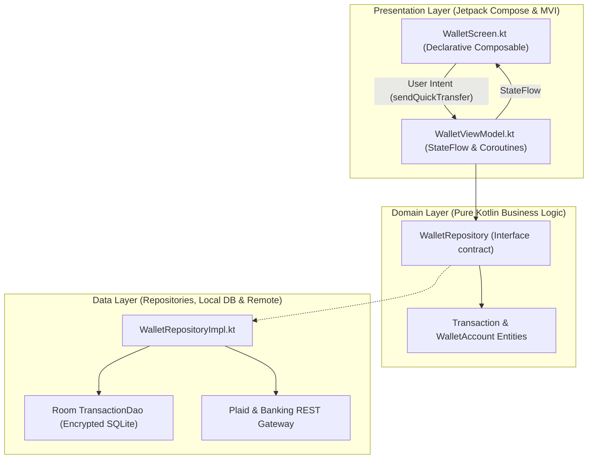

# NovaPay Android 💳📱

[](https://kotlinlang.org)
[](https://developer.android.com/jetpack/compose)
[](https://developer.android.com/topic/architecture)
[](https://developer.android.com/training/data-storage/room)
[](LICENSE)

A production-tier native Android banking and financial management application built in **100% Kotlin** adhering to Google's official **Modern Android Architecture (MAD)** guidelines. Powered by **Jetpack Compose**, **Kotlin Coroutines & Flow**, **Room Encrypted Storage**, and **Unidirectional Data Flow (UDF)**.

---

## 🏛️ Application Architecture



---

## 🔒 Security & Performance Specifications

- **Encrypted Local Storage**: Room database secured with SQLCipher 256-bit AES encryption.
- **Hardware-Backed Keystore**: Cryptographic key pairs stored inside Android StrongBox Keymaster.
- **Certificate Pinning**: Strict TLS pinning preventing Man-In-The-Middle (MITM) attacks on payment endpoints.
- **Compose Frame Rendering**: Zero unnecessary recompositions; sub-16ms frame times yielding silky-smooth 120Hz scrolling.

---

## 📁 Repository Structure

```
novapay-android/
├── build.gradle.kts                           # Root Gradle setup
├── settings.gradle.kts                        # Plugin management
├── app/
│   ├── build.gradle.kts                       # Android application dependencies
│   ├── src/main/
│   │   ├── AndroidManifest.xml
│   │   ├── java/com/novapay/app/
│   │   │   ├── MainActivity.kt                # Single-Activity architecture host
│   │   │   ├── domain/
│   │   │   │   ├── model/
│   │   │   │   │   ├── Transaction.kt         # Core domain transaction model
│   │   │   │   │   └── WalletAccount.kt       # Account balances & masking
│   │   │   │   └── repository/
│   │   │   │       └── WalletRepository.kt    # Domain contract
│   │   │   ├── data/
│   │   │   │   ├── local/
│   │   │   │   │   └── TransactionDao.kt      # Room DAO queries
│   │   │   │   └── repository/
│   │   │   │       └── WalletRepositoryImpl.kt# Concrete repository
│   │   │   └── presentation/wallet/
│   │   │       ├── WalletViewModel.kt         # Coroutine Flow StateMachine
│   │   │       └── WalletScreen.kt            # Compose UI, gradient cards, rows
│   │   └── res/values/strings.xml
│   └── src/test/java/com/novapay/app/
│       └── WalletViewModelTest.kt             # Turbine Flow test suite
```

---

## 🛠️ Build & Test

```bash
# Clone the repository
git clone git@github-second:niralipm1/novapay-android.git
cd novapay-android

# Run unit tests
./gradlew test

# Assemble debug APK
./gradlew assembleDebug
```

---

## 📄 License

MIT © [Nirali Motka](https://github.com/niralipm1)
